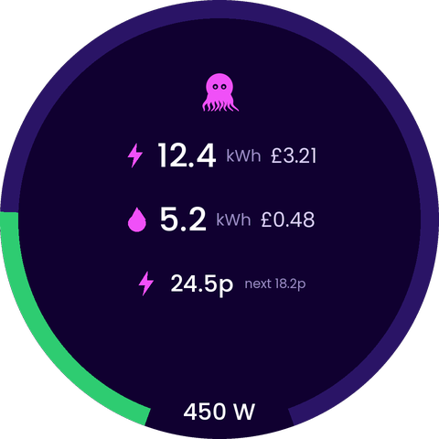
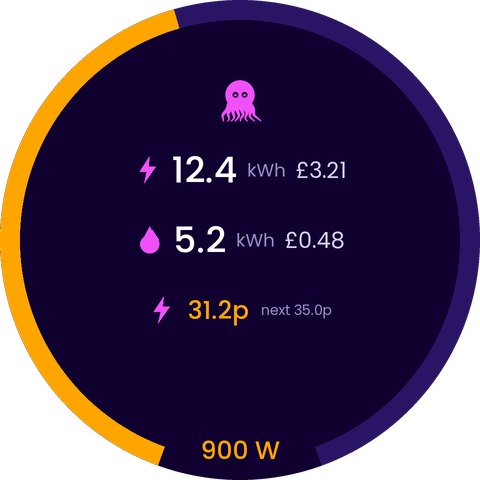
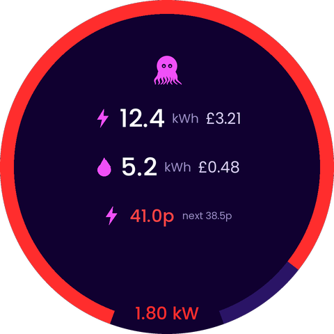
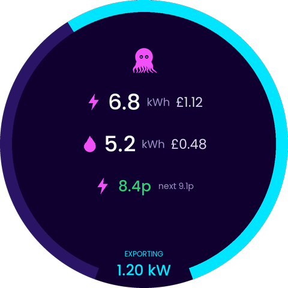

# hass-display

ESPHome config for a Waveshare ESP32-S3-Touch-LCD-2.1B (480x480 round display) that shows
Octopus Energy data from Home Assistant:

- Current and next unit rate (p/kWh), coloured by price
- Live usage (W/kW) as a progress ring that fills to a configurable maximum
- Today's usage (kWh) and cost so far
- Backlight timeout, woken by touch or a Home Assistant motion sensor
- A second page with just the logo; swipe left or right to switch pages

## Example screens

These are mockups drawn to match the layout, colours and thresholds in `hass-display.yaml`.
They are illustrative, not photos of the device, so fonts and exact pixels will differ slightly.

| Low usage | Medium usage | High usage |
|:---:|:---:|:---:|
|  |  |  |
| Under 500 W: green ring | 500 W and over: amber ring | 1200 W and over: red ring |

| Exporting | Page 2 |
|:---:|:---:|
|  |  |
| Negative usage: cyan ring fills from the opposite end, with an EXPORTING caption | Logo page, swipe left or right to switch |

How to read the main page:

- **Ring:** live usage, filling clockwise from the bottom left. A full ring is 2000 W (`ring_max_w`).
- **Top row:** today's electricity usage (kWh) and cost so far.
- **Middle row:** today's gas usage (kWh) and cost.
- **Price row:** the current electricity rate, coloured by price, with the next rate.
- **Bottom:** live usage as a number, in the gap in the ring.

## Requirements

- ESPHome 2026.10 or newer
- Home Assistant with the Octopus Energy integration
  (live usage and today's totals need an Octopus Home Mini)

## Setup

1. Copy `secrets.yaml.example` to `secrets.yaml` and fill in your values.
2. The logo is downloaded from this repo at compile time (see the `image:` block in `hass-display.yaml`), so the compile needs internet access. If you fork the repo, change the two URLs to point at your copy, and replace `octopus.png` with your own artwork if you like.
3. Edit the entity ID of your motion sensor near the bottom of `hass-display.yaml`.
4. Adjust the substitutions at the top (timeout, ring maximum, colour thresholds).
5. Compile and install with ESPHome, then add the device in Home Assistant
   (Settings > Devices & services > ESPHome).

`secrets.yaml` is git-ignored. Do not commit it.
